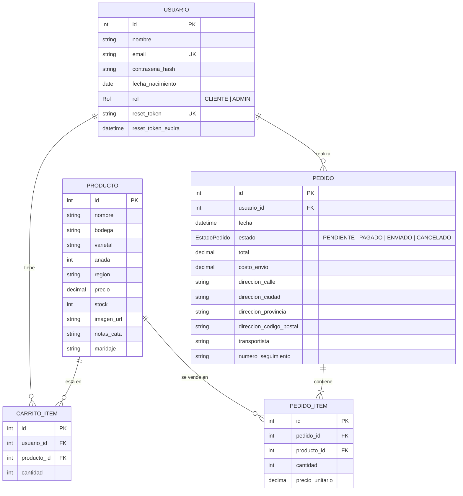
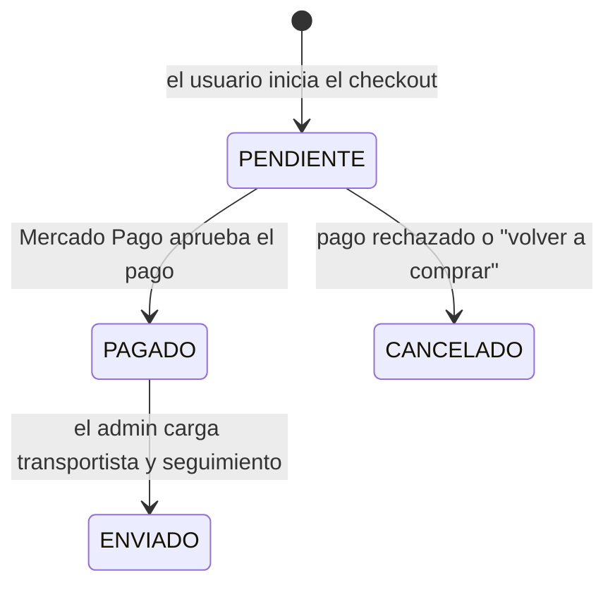

# Modelo de datos

El esquema vive en [`prisma/schema.prisma`](../prisma/schema.prisma) y cada cambio queda versionado como migración en `prisma/migrations/`. La base es PostgreSQL.

## Diagrama

## Tablas

| Tabla | Para qué sirve |
|---|---|
| `usuarios` | Cuentas de clientes y administradores. La contraseña se guarda hasheada (bcrypt). `reset_token` y `reset_token_expira` se usan solo en la recuperación de contraseña. |
| `productos` | Catálogo de vinos, con su ficha (bodega, varietal, añada, región, notas de cata, maridaje) y el stock disponible. |
| `carrito_items` | Carrito persistente: una fila por usuario y producto. |
| `pedidos` | Compra confirmada por el usuario, con su estado, el total, el costo de envío, la dirección de entrega y los datos del despacho. |
| `pedido_items` | Detalle de cada pedido: qué producto, cuántas unidades y a qué precio. |

## Decisiones de diseño

- **`carrito_items` es único por `(usuario_id, producto_id)`**: un usuario no puede tener el mismo vino dos veces; si lo vuelve a agregar, se suma la cantidad.
- **`pedido_items.precio_unitario` guarda el precio del momento de la compra.** Así el historial no cambia si después se modifica el precio del producto.
- **El dinero usa `Decimal`**, no `Float`, para evitar errores de redondeo.
- **El rol y el estado del pedido son enums**: la base rechaza valores inválidos.
- **Los pedidos no se borran con el producto**: no se puede eliminar un producto que figure en un pedido o en un carrito (error `P2003` de Prisma, que el backend traduce a un 409).
- **El stock se descuenta recién cuando el pago se confirma**, no al crear el pedido.

## Estados de un pedido

## Migraciones

| Migración | Qué hace |
|---|---|
| `init` | Usuarios, productos, pedidos y sus items. |
| `agregar_carrito` | Tabla `carrito_items`. |
| `agregar_reset_password` | Campos de recuperación de contraseña en `usuarios`. |
| `agregar_direccion_y_envio` | Dirección de entrega, transportista y número de seguimiento en `pedidos`. |
| `agregar_costo_envio` | Campo `costo_envio` en `pedidos`. |
